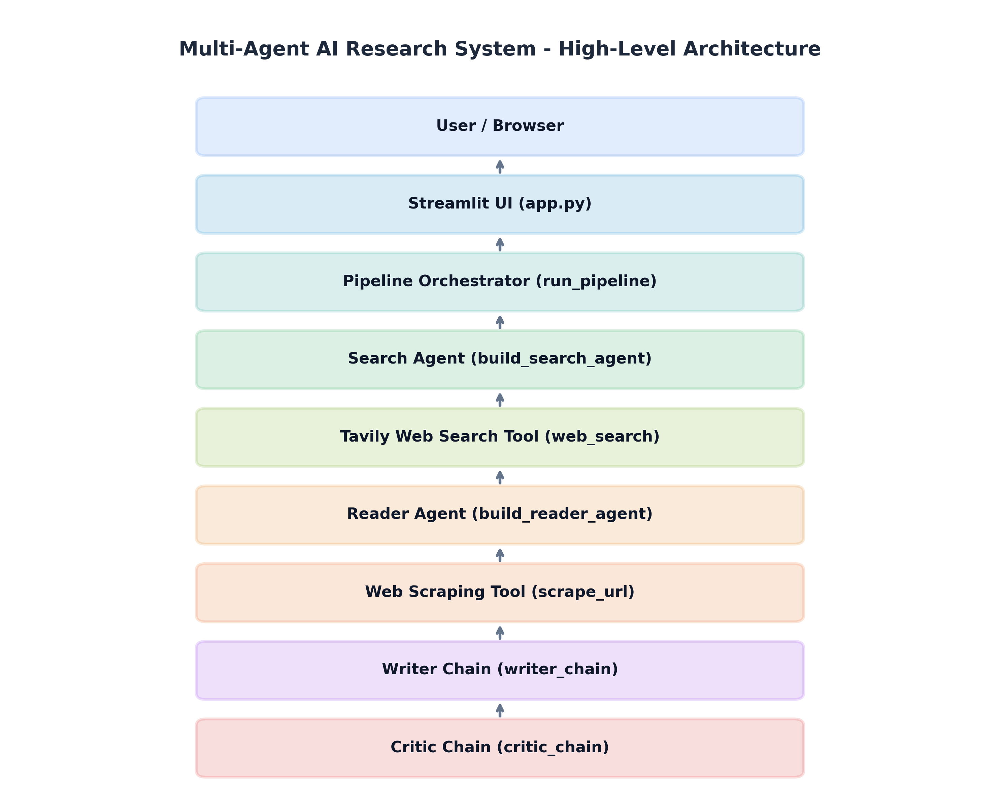
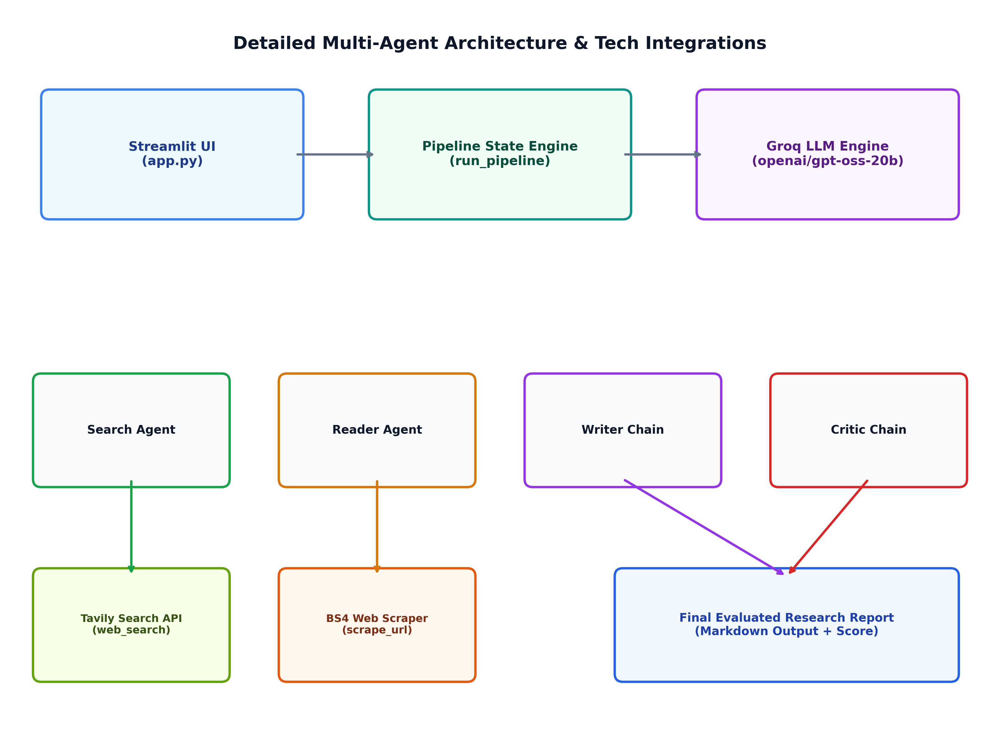
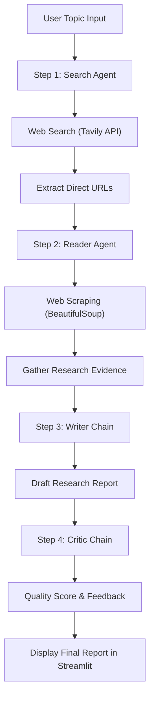

# Multi-Agent AI Research System


A specialized multi-agent research pipeline that automates web search, webpage content extraction, report drafting, and quality evaluation. Powered by **LangChain**, **Groq LLM Inference**, **Tavily Search API**, and **Streamlit**.

---

## 📌 Overview

The **Multi-Agent AI Research System** is designed to overcome the core limitations of single-prompt LLM interactions—such as knowledge cutoff constraints, hallucinations, and shallow surface-level summaries. Instead of relying on a single AI prompt to synthesize web research, this system coordinates specialized agents and structured chains across a deterministic sequential pipeline.

By decomposing research into discrete functional roles—**Source Discovery**, **Deep Reading & Scraping**, **Report Drafting**, and **Quality Assessment**—the system ensures that final reports are grounded in verified, recent web data with clear citations and objective quality feedback.

---

## ✨ Key Features

* 🌐 **Automated Web Research:** Queries recent web data using the Tavily Search API.
* 🔗 **Source Discovery & URL Extraction:** Extracts direct HTTP/HTTPS source links across search agent outputs and tool metadata.
* 📖 **Deep Content Reading & Scraping:** BeautifulSoup-powered web scraping to extract body content, key statistics, and evidence from web pages.
* ✍️ **Structured Report Synthesis:** Generates detailed Markdown research reports containing an Introduction, Key Findings, Conclusion, and Sources section.
* 🧐 **Automated Critic Evaluation:** Assesses generated reports objectively, providing an integer quality score out of 10, structured strengths, areas to improve, and a final verdict.
* 💻 **Streamlit Web Dashboard:** Interactive web UI with real-time status updates, metric cards, tabbed views, and downloadable Markdown reports.
* ⚙️ **Resilient Error Handling:** Friendly notifications for API rate limits (HTTP 429) and provider overload (HTTP 503).

---

## 🏗️ Architecture

The system executes a deterministic 4-step pipeline without unnecessary LLM loop overhead:

```text
User Topic Input
       │
       ▼
 ┌───────────┐      Search Tool      ┌──────────────┐
 │  Search   │ ────────────────────> │  Tavily API  │
 │   Agent   │ <──────────────────── └──────────────┘
 └─────┬─────┘     Titles, URLs, Snippets
       │
       ▼
 ┌───────────┐      Scrape Tool      ┌──────────────┐
 │  Reader   │ ────────────────────> │ BeautifulSoup│
 │   Agent   │ <──────────────────── └──────────────┘
 └─────┬─────┘     Raw Page Content
       │
       ▼
 ┌───────────┐
 │  Writer   │ ──> Generates Markdown Draft
 │   Chain   │
 └─────┬─────┘
       │
       ▼
 ┌───────────┐
 │  Critic   │ ──> Evaluates & Scores (X/10)
 │   Chain   │
 └─────┬─────┘
       │
       ▼
 Final Research Report & Feedback
```

### High-Level Architecture Diagram


### Detailed Multi-Agent Architecture


---

## 🔄 Pipeline Workflow



### Execution Steps:
1. **User Topic Input:** The user provides a research query in the Streamlit application or CLI.
2. **Search Agent (Step 1):** The Search Agent calls the `web_search` tool (powered by Tavily) to retrieve titles, snippets, and URLs.
3. **URL Extraction:** Plaintext URLs and Markdown links are extracted across all tool outputs and message history.
4. **Reader Agent (Step 2):** Top URLs are passed to the Reader Agent, which executes `scrape_url` using BeautifulSoup to extract body text and key evidence.
5. **Writer Chain (Step 3):** Combines raw search results and scraped evidence, synthesizing a structured Markdown report.
6. **Critic Chain (Step 4):** Evaluates the draft report strictly against completeness and factual grounding, outputting a score out of 10 and detailed feedback.
7. **Final Output:** The final report, critic feedback, scraped evidence, and source URLs are rendered in Streamlit with a download button.

> [!NOTE]
> The Critic evaluates the report **once** for quality scoring. There is intentionally **no automatic revision loop** in order to avoid token bloat and context exhaustion.

---

## 🤖 Multi-Agent Roles & Responsibilities

| Component | Role / Responsibility | Underlying Technology |
| :--- | :--- | :--- |
| **Search Agent** | Formulates web queries and discovers recent online sources | `create_agent`, `ChatGroq`, Tavily API (`web_search`) |
| **Reader Agent** | Receives top URLs and extracts detailed text evidence from webpages | `create_agent`, `ChatGroq`, BeautifulSoup4 (`scrape_url`) |
| **Writer Chain** | Synthesizes search results and scraped evidence into a cohesive report | `ChatPromptTemplate` \| `ChatGroq` \| `StrOutputParser` |
| **Critic Chain** | Evaluates report quality, lists strengths/weaknesses, and assigns a score | `ChatPromptTemplate` \| `ChatGroq` \| `StrOutputParser` |

---

## 🛠️ Tech Stack

| Category | Technology | Usage in Project |
| :--- | :--- | :--- |
| **Language** | Python 3.12+ | Core programming language |
| **Agent Framework** | LangChain / `langchain-groq` | Agent creation, chain piping, output parsing |
| **LLM Provider** | Groq Cloud | Ultra-fast LLM inference engine (`ChatGroq`) |
| **Search API** | Tavily (`tavily-python`) | Web search API optimized for LLMs |
| **Web Scraping** | BeautifulSoup4 / Requests | HTML parsing, DOM cleaning, text extraction |
| **Web Interface** | Streamlit | Dashboard UI, status progress, tabs, metrics |
| **Environment** | `python-dotenv` | Secure API key management |

---

## 📁 Project Structure

```text
MULTI AGENT SYSTEM/
├── app.py              # Streamlit web interface and UI orchestration
├── pipeline.py         # Standalone CLI / programmatic pipeline execution
├── agents.py           # Agent builders (Search, Reader) and chains (Writer, Critic)
├── tools.py            # Custom LangChain tools (web_search, scrape_url)
├── .env                # Local environment variables (API keys - gitignored)
├── .env.example        # Environment variable template
├── requirements.txt    # Python dependencies list
├── pyproject.toml      # Project configuration and script entrypoints
├── README.md           # Project documentation
└── docs/               # Visual architecture diagrams
    ├── architecture.png
    ├── detailed-architecture.png
    ├── pipeline-flow.png
    └── workflow.png
```

---

## 🚀 Installation & Setup

### Prerequisites
* Python 3.12 or higher
* Groq API Key ([Get Groq API Key](https://console.groq.com/))
* Tavily Search API Key ([Get Tavily API Key](https://tavily.com/))

### 1. Clone the Repository
```bash
git clone https://github.com/your-username/multi-agent-system.git
cd "MULTI AGENT SYSTEM"
```

### 2. Create and Activate Virtual Environment
**On Windows (PowerShell):**
```powershell
python -m venv .venv
.venv\Scripts\activate
```

**On Linux / macOS:**
```bash
python3 -m venv .venv
source .venv/bin/activate
```

### 3. Install Dependencies
```bash
pip install -r requirements.txt
```

---

## 🔑 Environment Variables Setup

Create a `.env` file in the root directory (or copy `.env.example`):

```bash
cp .env.example .env
```

Populate `.env` with your API keys:

```env
GROQ_API_KEY="gsk_your_groq_api_key_here"
TAVILY_API_KEY="tvly-your_tavily_api_key_here"
```

---

## 💻 Running the Application

### Option A: Streamlit Web Dashboard (Recommended)
Launch the interactive web UI:

```bash
streamlit run app.py
```

Open your browser at `http://localhost:8501`.

### Option B: Terminal / CLI Mode
Run the standalone pipeline script directly in the terminal:

```bash
python pipeline.py
```

You will be prompted to enter a research topic:
```text
Enter a research topic: Impact of Artificial Intelligence on Higher Education
```

---

## 📊 Application Output & User Interface

When running the Streamlit app (`app.py`), the user receives:
1. **Live Step-by-Step Status Expanders:** Visual indicators for Search, Reader, Writer, and Critic execution.
2. **Metric Cards:**
   * **Critic Score:** Overall quality rating (e.g. `8/10`).
   * **Sources Found:** Total count of valid extracted URLs.
3. **Tabbed Results View:**
   * **📄 Final Report:** Formatted Markdown report with a `⬇️ Download report (.md)` button.
   * **🧐 Critic Feedback:** Breakdown of Strengths, Areas to Improve, and One-line Verdict.
   * **📖 Scraped Content:** Extracted deep text from web pages.
   * **🔎 Search Results:** Raw Tavily search snippets and extracted source URLs.

---

## 🛡️ Error Handling & Resilience

* **Rate Limit Handling (HTTP 429):** Displays a warning modal if Groq or Tavily API quotas are exceeded.
* **Provider Overload (HTTP 503):** Warns the user gracefully if the backend inference engine is temporarily unavailable.
* **Missing URLs Guard:** If Search returns no URLs, the Reader Agent step safely skips scraping and passes search snippets directly to the Writer to prevent hallucinated URLs.
* **Technical Error Details:** Technical stack traces are captured inside a collapsible `st.expander` to keep the UI clean.

---

## 🧠 Key Design Decisions

* **Why Multiple Specialized Agents?**  
  Decomposing tasks into specialized roles prevents prompt distraction, ensures deterministic tool execution, and improves output consistency.
* **Why Separate Search and Reader Agents?**  
  Searching requires broad discovery across search engine snippets, while reading requires deep DOM parsing of specific URLs. Separating them isolates scraping failures from query formation.
* **Why Use a Critic Agent?**  
  An independent evaluation step gives users an objective metric of report quality without introducing latency-heavy revision loops.
* **Why Groq & Tavily?**  
  Groq provides ultra-fast LLM inference speed, while Tavily offers search results tailored specifically for RAG and AI agent ingestion.

---

## ⚠️ Current Limitations

* **Single-Pass Pipeline:** The system intentionally does not auto-revise reports based on Critic feedback to conserve API tokens.
* **Static Scraping:** BeautifulSoup handles standard HTML pages well but cannot execute client-side JavaScript on dynamic single-page web applications.
* **Rate Limits:** Free-tier API keys for Groq and Tavily are subject to daily request and token limits.

---

## 🔮 Future Improvements (Roadmap)

* [ ] **Parallel Web Scraping:** Scrape multiple URLs concurrently using `asyncio` for faster throughput.
* [ ] **Headless Browser Integration:** Add Playwright or Selenium support for JavaScript-rendered web pages.
* [ ] **Citation Footnotes:** Automatically link specific numerical claims back to exact source URLs.
* [ ] **Export Options:** Support export to PDF and DOCX formats in addition to Markdown.

---

## 📜 License

License information has not been specified yet.
